# Smart Resume Analyzer — AI HR Interview

A mobile recruitment app where job seekers upload a resume, get an instant match score against a job's requirements, and take a short AI-led HR interview. Recruiters post jobs, review candidates and shortlist or reject them.

This repository holds the **UI design** (13 mobile screens built in Google Stitch) and the **database design** (ERD with 6 tables).

---

## Design (`/design`)

13 simple, single-purpose screens in one green-and-white style, all at a 390 × 844 phone size.

- `design/Smart_Resume_Analyzer_Screens.pdf` — all 13 screens in one PDF
- `design/screens/` — one PNG preview per screen
- `design/stitch-source/` — source code exported from Stitch (one `code.html` per screen) and the design system notes

### Job seeker flow

<table>
  <tr>
    <td align="center">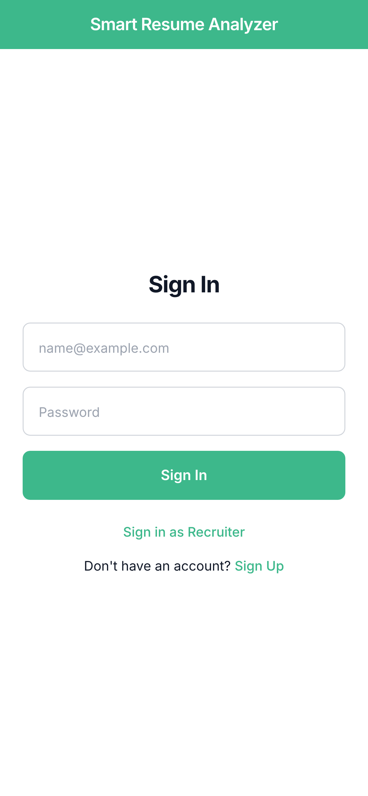<br><sub>1. Sign In</sub></td>
    <td align="center">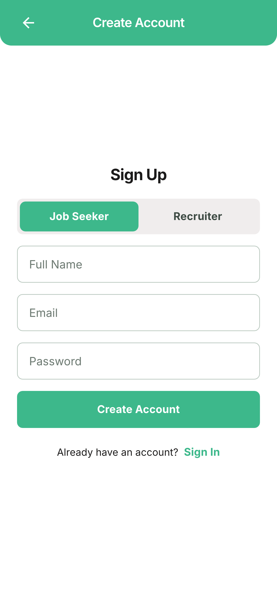<br><sub>2. Sign Up</sub></td>
    <td align="center">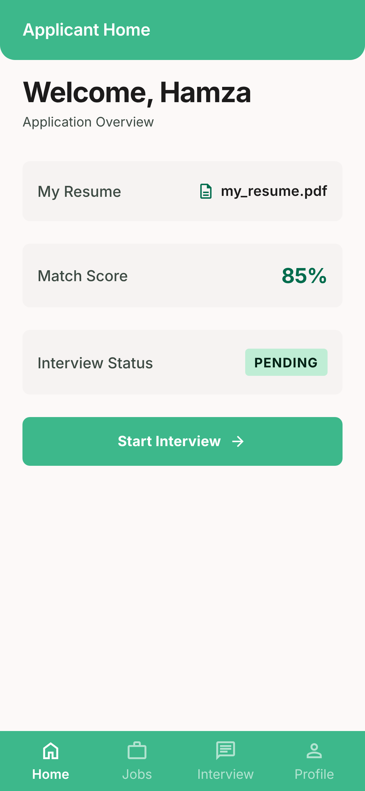<br><sub>3. Applicant Home</sub></td>
    <td align="center">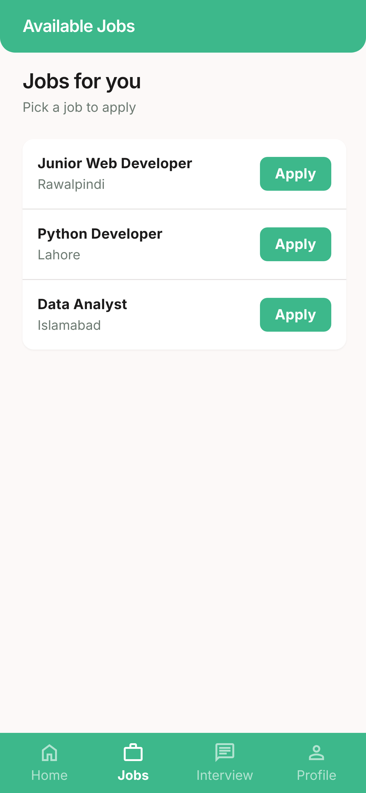<br><sub>4. Available Jobs</sub></td>
  </tr>
  <tr>
    <td align="center">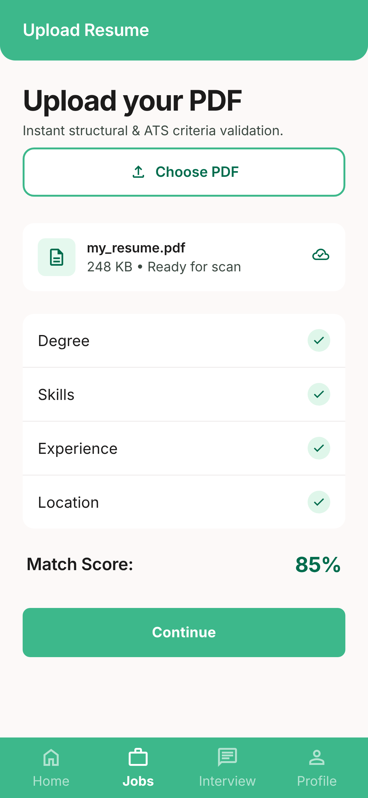<br><sub>5. Upload Resume</sub></td>
    <td align="center">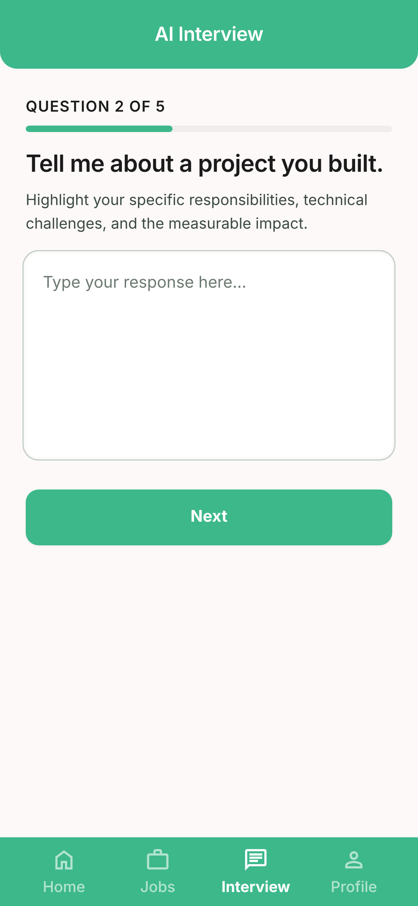<br><sub>6. AI Interview</sub></td>
    <td align="center">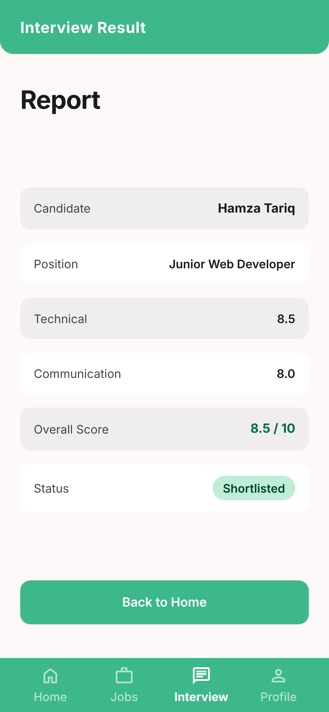<br><sub>7. Interview Result</sub></td>
    <td align="center">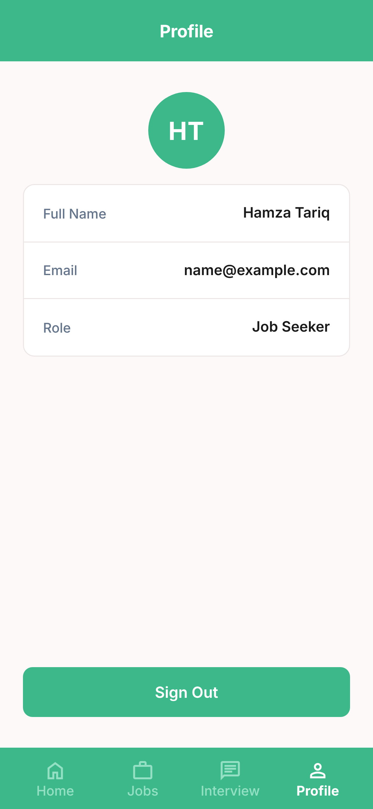<br><sub>8. Profile</sub></td>
  </tr>
</table>

### Recruiter flow

<table>
  <tr>
    <td align="center">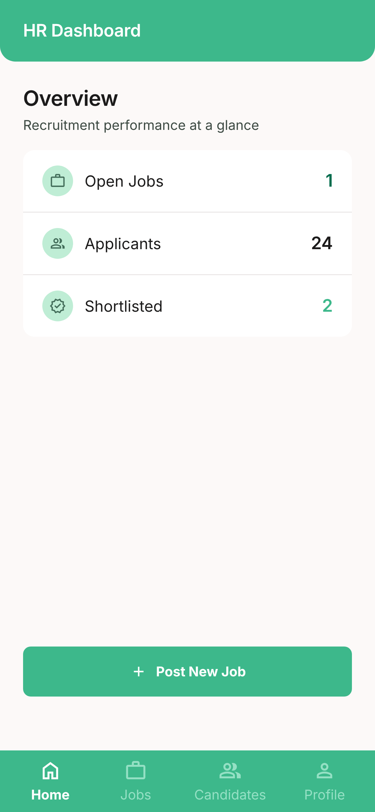<br><sub>9. HR Dashboard</sub></td>
    <td align="center">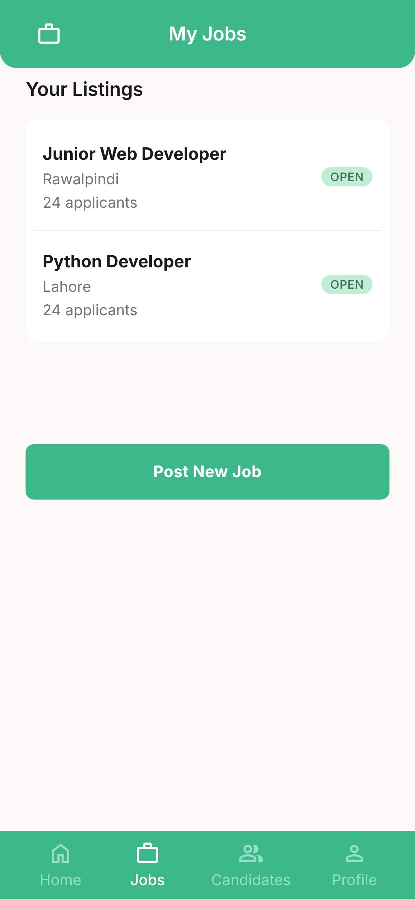<br><sub>10. My Jobs</sub></td>
    <td align="center">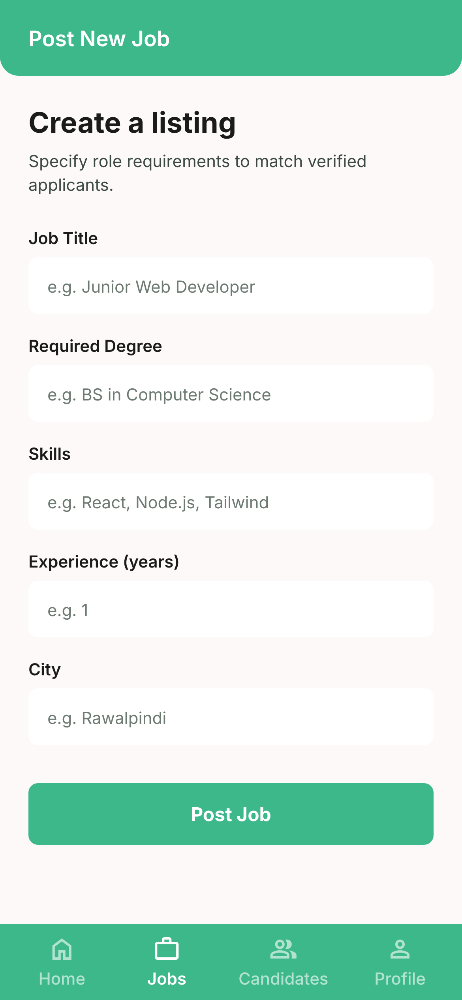<br><sub>11. Post New Job</sub></td>
    <td align="center">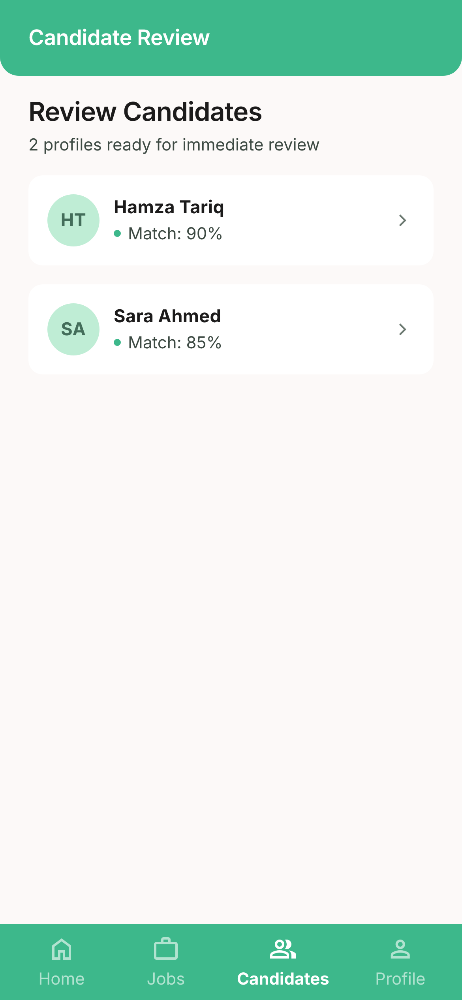<br><sub>12. Candidate Review</sub></td>
    <td align="center">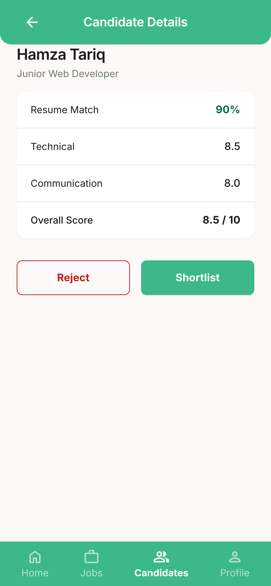<br><sub>13. Candidate Details</sub></td>
  </tr>
</table>

---

## Database (`/database`)

`database/Smart_Resume_Analyzer_ERD_v4.png` — the ERD, matched to the 13 screens above.

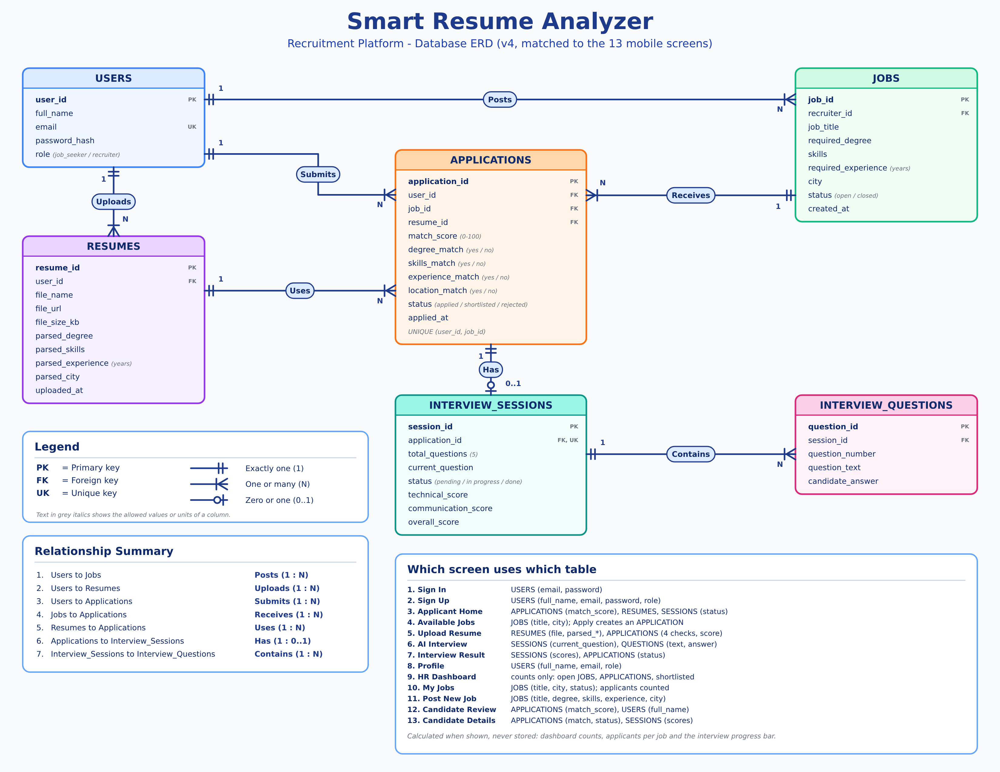

| Table | What it stores |
|-------|----------------|
| `USERS` | Name, email, password hash and role (job seeker or recruiter) |
| `JOBS` | Job title, required degree, skills, experience, city and status |
| `RESUMES` | The uploaded PDF and the details read from it |
| `APPLICATIONS` | A job seeker applying to a job: match score, four match checks and status |
| `INTERVIEW_SESSIONS` | One AI interview per application: progress and scores |
| `INTERVIEW_QUESTIONS` | Each question asked and the candidate's answer |

---

## How the app works

1. A person signs up as a **job seeker** or a **recruiter**
2. A recruiter posts a job (title, degree, skills, experience, city)
3. A job seeker picks a job, uploads a PDF resume and sees an instant match score
4. The job seeker takes a short AI interview (5 questions)
5. The interview is scored (technical, communication, overall)
6. The recruiter reviews candidates and shortlists or rejects them

---

## Repository structure

```
smart-resume-analyzer-hr-interview/
├── README.md
├── design/
│   ├── Smart_Resume_Analyzer_Screens.pdf
│   ├── screens/            13 PNG previews
│   └── stitch-source/      Stitch code for each screen + design system notes
└── database/
    └── Smart_Resume_Analyzer_ERD_v4.png
```

## Status

UI design and database design complete. Implementation in progress.

## Author

Sammar — [GitHub](https://github.com/sammar-abbas-shah) · [LinkedIn](https://linkedin.com/in/sammar-abbas-372359289)
