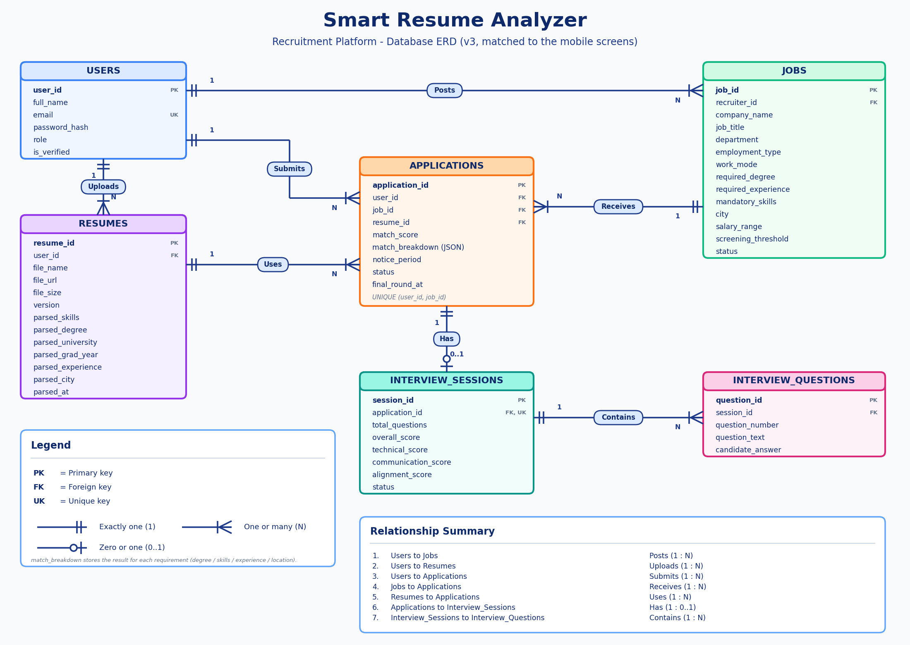

# Smart Resume Analyzer — AI HR Interview

A mobile recruitment platform where job seekers upload a resume, get an instant AI match score against job requirements, and take an AI-led HR interview, while recruiters post jobs and review ranked candidates.

## Project

### Design (`/design`)
8 mobile screens designed in Google Stitch:

| # | Screen |
|---|--------|
| 1 | Sign In |
| 2 | Applicant Dashboard |
| 3 | Resume Upload & Validation |
| 4 | AI HR Interview |
| 5 | Interview Result |
| 6 | HR Dashboard |
| 7 | Post New Job |
| 8 | Candidate Review |

- `design/PakTalent_AI_Screens.pdf` — all screens in one PDF
- `design/stitch-screens/` — source screens exported from Stitch (PNG + HTML)

### Database (`/database`)
- `Smart_Resume_Analyzer_ERD.png` — ERD with 6 tables: Users, Jobs, Resumes, Applications, Interview Sessions, Interview Questions
- `Project_ERD_Explanation.pdf` — the ERD explained in simple words

## How the app works
1. A person creates an account
2. A recruiter posts a job
3. A job seeker uploads a resume and the AI reads it
4. The job seeker applies and gets a match score
5. An AI interview is created for that application
6. The interview asks questions and records the answers

## Status
Design and database planning complete. Implementation in progress.

## Author
Sammar — [GitHub](https://github.com/sammar-abbas-shah) · [LinkedIn](https://linkedin.com/in/sammar-abbas-372359289)
